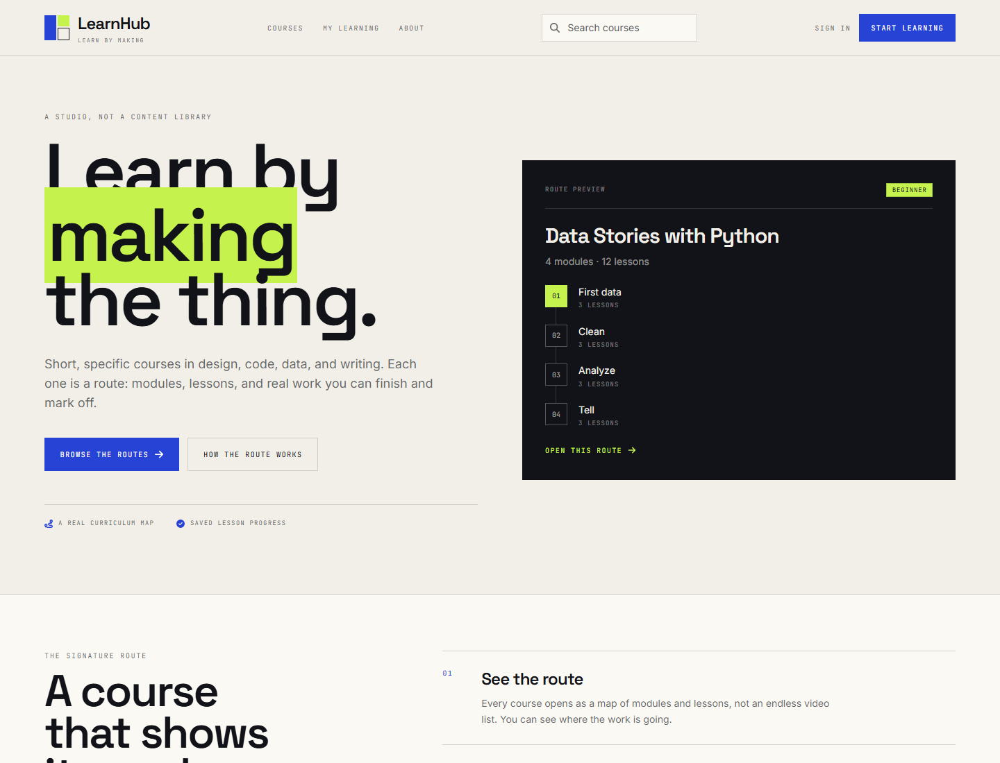
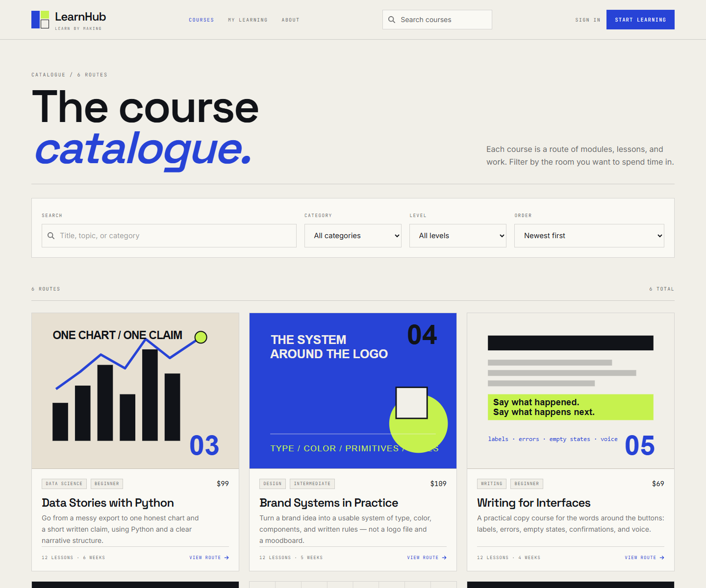
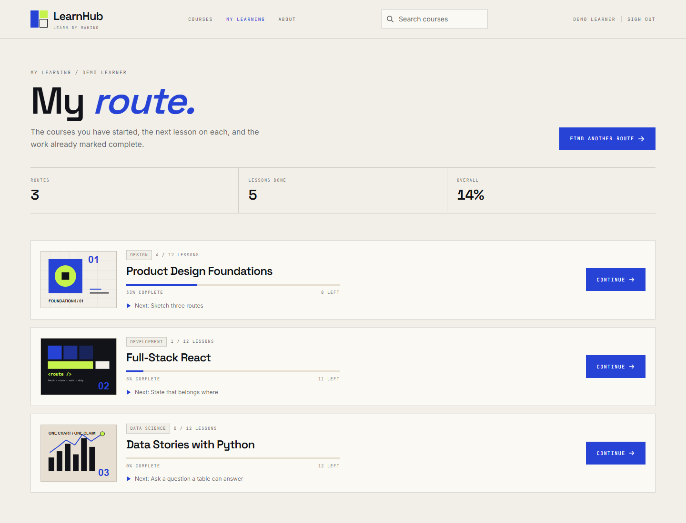
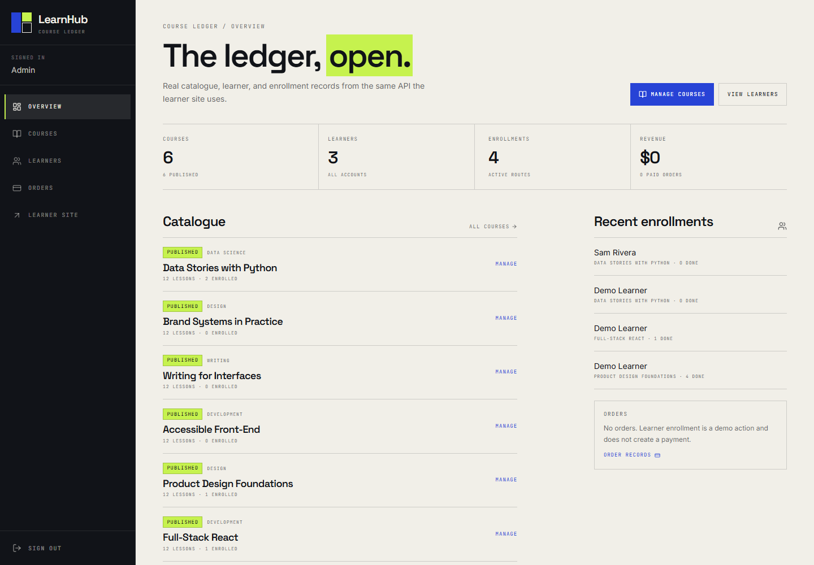

# LearnHub — Learn by making

A studio-style learning platform built around a **course route**: modules, lessons, labs, critiques, and projects, with lesson progress saved to the learner’s account. The public catalogue, enrollment, progress record, and admin course ledger are all backed by the API.

The visual system is documented in [`DESIGN.md`](DESIGN.md).

## The idea

Most course platforms present an endless content feed. LearnHub presents a route:

- **Modules** give the sequence.
- **Lessons, labs, critiques, and projects** tell you what kind of work you are sitting down to do.
- Every lesson names an **objective** — the thing you should be able to do afterwards.
- Progress is **account-scoped** and used to find the next open lesson.
- Enrollment is a **demo action**: no payment is taken in the learner flow.

## Stack

| Layer | Technology |
|---|---|
| Learner web | React 18 · Vite · Tailwind CSS · React Router |
| Admin | React 18 · Vite · Tailwind CSS |
| API | Node.js · Express · Zod · JWT |
| Data | MongoDB · Mongoose |
| Tests | Jest + Supertest with mongodb-memory-server |
| Deployment | Render: API web service + two static sites (Blueprint included) |

## Architecture

```
apps/
  api/
    src/
      models/       User, Course, Enrollment, Order
      routes/       auth, courses, me, payments, admin, webhooks
      services/     admin bootstrap, course seeder, Stripe webhook
      config/       env, DB, Stripe
  web/
    src/
      components/   Header, Footer, CourseCard, AuthFrame, ScrollToTop
      contexts/     AuthProvider
      pages/        Home, Courses, CourseDetail, MyCourses, About, Contact, auth
      lib/          API client, course progress helpers
  admin/
    src/
      components/   Ledger layout
      pages/        Overview, Courses, Learners, Orders, Login
docs/screenshots/
```

## What works

### Learner

- Register, sign in, and sign out with JWT auth.
- Browse the seeded catalogue with search, category, level, and sort.
- Open a course to see its outcomes, modules, and every lesson objective.
- Enroll in a course directly (demo action, no payment).
- Mark a lesson complete or open again; the API stores the lesson ID and last position.
- Continue from the next open lesson.
- My learning shows real per-course progress and overall completion.
- Mobile layouts and a native mobile menu.

### Admin ledger

- Real course, learner, enrollment, and order counts from the API.
- Create a course, edit its details, publish or unpublish it, and delete it.
- Live enrollment counts per course.
- Learner account list and an honest empty state for orders.
- Seeded administrator access only; learner accounts cannot enter the console.

### API

```
POST   /api/auth/register
POST   /api/auth/login
GET    /api/auth/me

GET    /api/courses
GET    /api/courses/:id

GET    /api/me/enrollments
POST   /api/me/enrollments
PUT    /api/me/enrollments/:courseId/progress

GET    /api/admin/stats
GET    /api/admin/courses
POST   /api/admin/courses
PATCH  /api/admin/courses/:id
DELETE /api/admin/courses/:id
GET    /api/admin/users
GET    /api/admin/enrollments
GET    /api/admin/orders

POST   /api/payments/checkout
POST   /api/webhooks/stripe
```

## What is verified

- **20 API tests** pass across auth, course creation, enrollment, progress, admin stats, and payments.
- Sign-up, sign-in, direct enrollment, lesson completion, and course progress persistence were exercised in a browser.
- The dedicated demo learner starts with three enrollments and five completed lessons.
- Production builds pass for the API, learner app, and admin app.
- No fake instructors, ratings, learner counts, revenue charts, or testimonials. The catalogue and progress are seeded/real respectively.

## Screenshots

| Home | Catalogue |
|---|---|
|  |  |

| Course record | The route |
|---|---|
|  |  |

| My learning | Admin ledger |
|---|---|
|  |  |

## Quick start

### Prerequisites

- Node.js 20+
- MongoDB running locally, or a MongoDB URI

### 1. Install

```bash
npm install
```

### 2. Environment

```bash
cp apps/api/.env.example apps/api/.env
cp apps/web/.env.example apps/web/.env
cp apps/admin/.env.example apps/admin/.env
```

Set `MONGODB_URI`, `JWT_SECRET`, `ADMIN_PASSWORD`, and `DEMO_PASSWORD` in `apps/api/.env`. Keep `STRIPE_MOCK=1` for the demo.

Set `VITE_API_URL=http://localhost:4000` in both frontend env files. Set `VITE_WEB_URL` in the admin env to the learner app URL.

### 3. Run

```bash
npm run dev
```

| App | URL |
|---|---|
| Learner web | http://localhost:5173 |
| Admin | http://localhost:3001 |
| API | http://localhost:4000 |

If port 5173 is already in use, Vite will choose another port; update `VITE_WEB_URL` in the admin env to match.

On first boot the API seeds **six courses / 72 lessons**, creates the single administrator, and creates the demo learner with three enrollments.

### Demo credentials

**Administrator**

```
Email:    admin@learnhub.example
Password: LearnHub123!
```

**Learner**

```
Email:    demo@learnhub.example
Password: LearnHubDemo123!
```

All courses, lesson copy, and accounts are seeded demo data. Do not enter personal information.

## Tests

```bash
npm test
```

API tests use an in-memory MongoDB instance.

## Deployment

`render.yaml` defines three Render resources:

- `learnhub-api` — Express API (`/api/health` health check)
- `learnhub-web` — static learner app
- `learnhub-admin` — static admin app

The static sites use SPA rewrites and bake `VITE_API_URL` at build time. Set the service URLs in `render.yaml` if you use a different naming scheme. Set `MONGODB_URI`, `ADMIN_PASSWORD`, and `DEMO_PASSWORD` in the Render dashboard; `JWT_SECRET` is generated.

Create a free MongoDB Atlas cluster, allow Render access, and run the API once to seed the catalogue. No Stripe keys are needed while `STRIPE_MOCK=1`.

## Notes

- The optional Stripe checkout path and webhook remain in the API for completeness, but the learner UI enrolls directly for the demo. No payment is taken.
- Course covers are bundled SVG assets in each frontend’s `public/courses` directory.
- The admin console reads only real records; it does not invent analytics.
