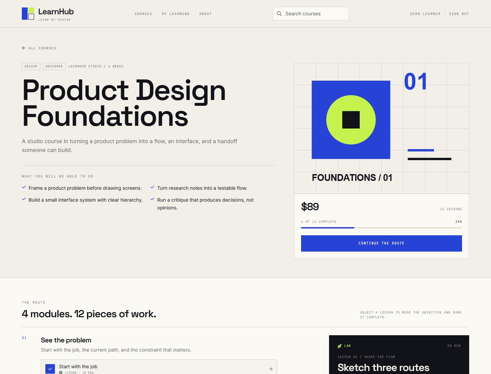
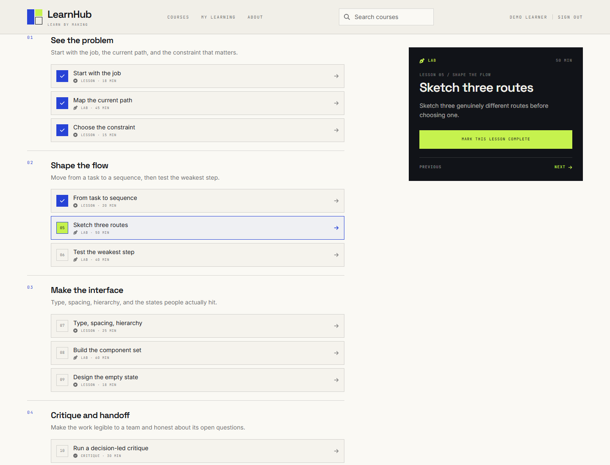

# LearnHub

> A course route that always shows the next piece of work.

[](https://learnhub.furqankhan.dev)
[](https://furqankhan.dev)
[](LICENSE)

LearnHub is a studio-style learning platform for people who want a sequence rather than an endless content feed. A course is a visible route of modules and lessons, each lesson names the work it should make possible, and progress follows the learner's account. A separate admin ledger manages the catalogue and reads the enrollment record.

Part of [Furqan Khan's portfolio](https://furqankhan.dev).

**Live:** https://learnhub.furqankhan.dev · **Source:** https://github.com/fk219/Learn-Hub · **Case study:** https://furqankhan.dev

## What it is

The repository is a three-app monorepo:

- `apps/web` is the learner app: catalogue, course record, enrollment, lesson progress, and "My learning".
- `apps/admin` is the admin ledger: course management, learners, enrollments, and orders.
- `apps/api` is a single Express API backed by MongoDB.

On first boot the API seeds six courses with 72 lessons, one administrator, and a demo learner with three active enrollments. The learner's progress is stored in MongoDB and is scoped to their account, not to the browser.

## The signature idea

Most course sites present a feed. LearnHub presents a route:

```
module -> lesson -> lab -> critique -> project
```

A course is an ordered set of modules. Each module contains lessons, and every lesson carries a `kind` (`lesson`, `lab`, `critique`, or `project`), an estimated duration, and an objective. The UI reads the route in order, then uses the learner's completed lesson IDs to find the first lesson that is still open. That lesson becomes the "next" action on the course page and on My learning.

Because progress is account-scoped, signing in on another browser restores the same route position. Enrollment is a demo action in the learner flow; no payment is taken.

## What works

### Learner

- Register, sign in, and sign out with JWT authentication.
- Browse the seeded catalogue with search, category, level, and sort controls.
- Open a course to read its outcomes, modules, lesson objectives, and lesson kinds.
- Enroll directly from the course page (demo action, no payment).
- Mark a lesson complete or move it back to open. The API stores the lesson ID and the last selected lesson.
- Continue from the next open lesson, with per-course and overall completion percentages.
- Use responsive layouts and a mobile navigation menu.

### Admin ledger

- Real course, learner, enrollment, order, and paid-order counts from the API.
- Create a course, edit its details, publish or unpublish it, and delete it.
- Live enrollment counts per course, calculated from the enrollment records.
- A learner account list and an order view that explains why the seeded demo has no payment records.
- Seeded administrator access only. A learner token is rejected by the admin routes and by the admin app.

The console does not invent instructors, ratings, learner counts, revenue charts, or testimonials. It reads records that exist in the database.

## Screenshots

| Home | Catalogue |
|---|---|
|  |  |

| Course record | The route |
|---|---|
|  |  |

| My learning | Admin ledger |
|---|---|
|  |  |

## Tech stack in detail

| Layer | Technology | What it does here |
|---|---|---|
| Learner app | React 18, Vite 4, Tailwind CSS, React Router 6 | Catalogue, course route, auth screens, progress UI |
| Admin app | React 18, Vite 4, Tailwind CSS, React Router 6 | Ledger layout and course, learner, and order views |
| API | Node.js, Express 4 | REST surface under `/api`, CORS, Helmet, central error handling |
| Validation | Zod 4 | Request schemas for auth, admin course writes, enrollment, and progress |
| Auth | `jsonwebtoken`, `bcryptjs` | Bearer access tokens, password hashing, admin role guard |
| Data | MongoDB, Mongoose 8 | `User`, `Course`, `Enrollment`, and `Order` models |
| Payments (optional) | Stripe SDK | Mock checkout and webhook path; not used by the learner demo flow |
| Tests | Jest 29, Supertest, `mongodb-memory-server` | 20 API tests against an in-memory database |
| Deployment | Render Blueprint, MongoDB Atlas | One API web service and two static app builds |

## Architecture

The learner and admin apps are static React builds. Both call the same Express API with a bearer token; the admin app additionally requires the `admin` role. The API owns validation, authentication, enrollment, progress, course writes, and the optional Stripe webhook. MongoDB is the only persistent store.

```
Learner app ──┐
              ├── HTTPS + JWT ──> Express API ──> MongoDB
Admin ledger ─┘                       │
                                      └── optional Stripe checkout/webhook
```

Repository layout:

```
apps/
  api/
    src/
      config/       env, database, Stripe
      middleware/   JWT auth, admin guard
      models/       User, Course, Enrollment, Order
      routes/       auth, courses, me, payments, admin, webhooks
      services/     admin bootstrap, JWT, password, course seed, slug, Stripe webhook
    tests/          6 Jest suites
  web/
    src/
      components/   header, footer, course card, auth frame
      contexts/     auth provider
      lib/          API client, course progress helpers
      pages/        home, catalogue, course, my learning, auth, about, contact
  admin/
    src/
      components/   ledger layout
      lib/          admin API client
      pages/        overview, courses, learners, orders, login
docs/screenshots/
render.yaml
```

## Run it locally

### Prerequisites

- Node.js 22 (the version in `.nvmrc` and the Render builds)
- MongoDB running locally, a MongoDB Atlas URI, or no URI at all for the in-memory development fallback

### Install

```bash
npm install
```

This installs the root workspace tooling and all three workspaces.

### Environment

```bash
cp apps/api/.env.example apps/api/.env
cp apps/web/.env.example apps/web/.env
cp apps/admin/.env.example apps/admin/.env
```

| Name | Required | Purpose |
|---|---|---|
| `MONGODB_URI` | Production; optional in development | MongoDB connection string. If unset in development, the API starts `mongodb-memory-server`. |
| `JWT_SECRET` | Yes | Signs and verifies access tokens. Auth requests fail without it outside tests. |
| `JWT_EXPIRES_IN` | No | Token lifetime. `.env.example` uses `7d`; the code fallback is `15m`. |
| `ADMIN_EMAIL` | Yes | Email for the single seeded administrator. |
| `ADMIN_PASSWORD` | Yes | Password for the seeded administrator. |
| `DEMO_EMAIL` | No | Email for the seeded demo learner. The demo learner is skipped if this or the password is unset. |
| `DEMO_PASSWORD` | No | Password for the seeded demo learner. |
| `CORS_ORIGINS` | No | Comma-separated allowed browser origins. Defaults to the local apps and the production domains. |
| `STRIPE_MOCK` | No | `1` parses webhook events without a Stripe signature. Keep it at `1` for the demo. |
| `STRIPE_SECRET_KEY` | No | Only needed for a real Stripe checkout session. |
| `STRIPE_WEBHOOK_SECRET` | No | Only needed when `STRIPE_MOCK` is not `1`. |
| `PORT` | No | API port; defaults to `4000`. |
| `VITE_API_URL` | Yes for both frontends | API base URL. Vite bakes it into the build. |
| `VITE_WEB_URL` | Admin app | Learner app URL used by the admin link. |

Set `VITE_API_URL=http://localhost:4000` in both frontend env files. Set `VITE_WEB_URL=http://localhost:5173` in the admin env.

### Run

```bash
npm run dev
```

| App | URL |
|---|---|
| Learner web | http://localhost:5173 |
| Admin ledger | http://localhost:3001 |
| API | http://localhost:4000 |

If port 5173 is already in use, Vite chooses another port. Update `VITE_WEB_URL` in the admin env to match.

On first boot the API seeds the catalogue, the administrator, and the demo learner. The seeded learner has three enrollments and four completed lessons.

### Demo access

| Role | Email | Password |
|---|---|---|
| Administrator | `admin@learnhub.example` | `LearnHub123!` |
| Learner | `demo@learnhub.example` | `LearnHubDemo123!` |

All courses, lesson copy, and accounts are seeded demo data. Do not enter personal information.

## API

All routes are prefixed with `/api`. Admin routes require a bearer token for a user with the `admin` role.

| Method | Path | Purpose |
|---|---|---|
| `GET` | `/api/health` | Returns `{ ok: true }`. |
| `POST` | `/api/auth/register` | Create a learner account and return an access token. |
| `POST` | `/api/auth/login` | Sign in and return an access token. |
| `GET` | `/api/auth/me` | Return the current user from the bearer token. |
| `GET` | `/api/courses` | List published courses. |
| `GET` | `/api/courses/:id` | Return one published course with its modules and lessons. |
| `GET` | `/api/me/enrollments` | List the current learner's active enrollments with course data. |
| `POST` | `/api/me/enrollments` | Enroll the current learner in a published course. |
| `PUT` | `/api/me/enrollments/:courseId/progress` | Mark a lesson complete or open, and save the last lesson. |
| `POST` | `/api/payments/checkout` | Create a mock Stripe checkout session and a pending order. |
| `POST` | `/api/webhooks/stripe` | Fulfill a completed checkout event; signature is checked unless `STRIPE_MOCK=1`. |
| `GET` | `/api/admin/stats` | Course, learner, enrollment, order, and paid-order totals. |
| `GET` | `/api/admin/courses` | List every course, including drafts. |
| `POST` | `/api/admin/courses` | Create a course and derive its slug. |
| `PATCH` | `/api/admin/courses/:id` | Update a course, including publish state. |
| `DELETE` | `/api/admin/courses/:id` | Delete a course and its enrollments. |
| `GET` | `/api/admin/users` | List up to 500 learner and admin accounts without password hashes. |
| `GET` | `/api/admin/enrollments` | List up to 500 active enrollments with learner and course references. |
| `GET` | `/api/admin/orders` | List up to 500 orders with learner and course references. |

## Tests

```bash
npm test
```

The root script runs the API suite: 20 Jest tests in six suites, using Supertest and `mongodb-memory-server`. The tests cover health, auth, published-course reads, admin course creation and access control, direct enrollment, lesson progress, and the mock Stripe checkout and webhook flow.

The CI workflow runs the same tests and then builds the API, learner app, and admin app.

## Deployment

`render.yaml` defines three Render resources:

- `learnhub-api` is the Express service. Its health check is `/api/health`.
- `learnhub-web` is a static site built from `apps/web`.
- `learnhub-admin` is a static site built from `apps/admin`.

Both static sites use a rewrite to `index.html` for client-side routes. `VITE_API_URL` is set at build time, and the admin build also receives `VITE_WEB_URL`. The blueprint generates `JWT_SECRET` and expects `MONGODB_URI`, `ADMIN_PASSWORD`, and `DEMO_PASSWORD` to be supplied in Render. If you use different Render service names or custom domains, update those URLs and set `CORS_ORIGINS` to match.

Create a MongoDB Atlas database, allow the Render service to connect, and start the API once so the catalogue and demo accounts are seeded. No Stripe keys are needed while `STRIPE_MOCK=1`.

## Limits and notes

- Enrollment in the learner UI is a demo action. No payment is taken, and the seeded order view is intentionally empty.
- The optional Stripe checkout and webhook code exists in the API, but the learner app enrolls directly.
- All course copy and demo accounts are seeded. The catalogue is not a live school.
- The admin console reads real records from MongoDB. It does not generate synthetic analytics.
- With no `MONGODB_URI` in development, the API uses an in-memory MongoDB instance. Data disappears when that process stops.
- Course cover images are bundled SVG assets in each app's `public/courses` directory.

## License

MIT. See [LICENSE](LICENSE).
